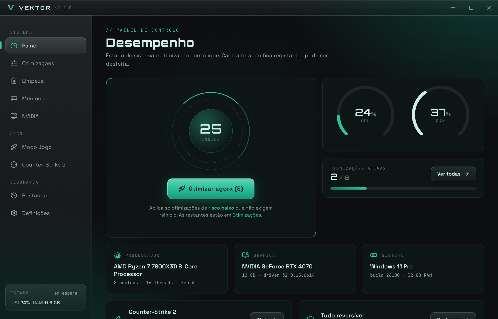
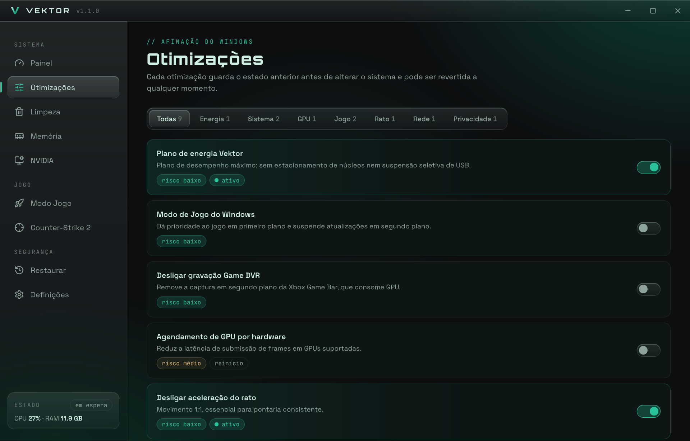
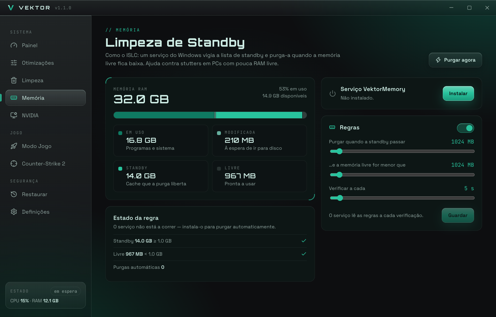
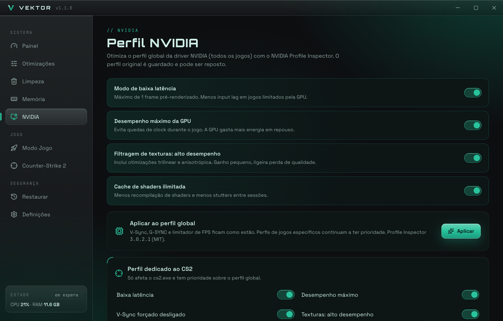
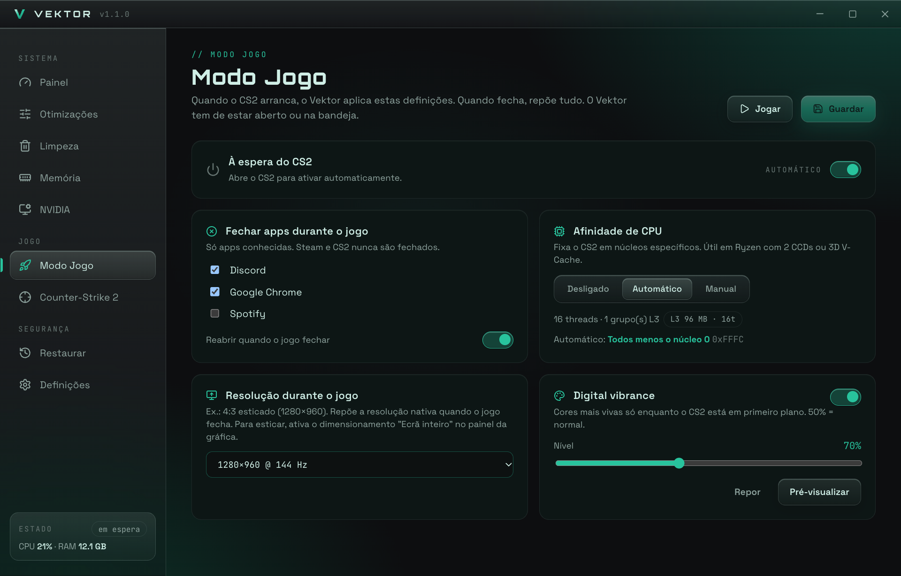
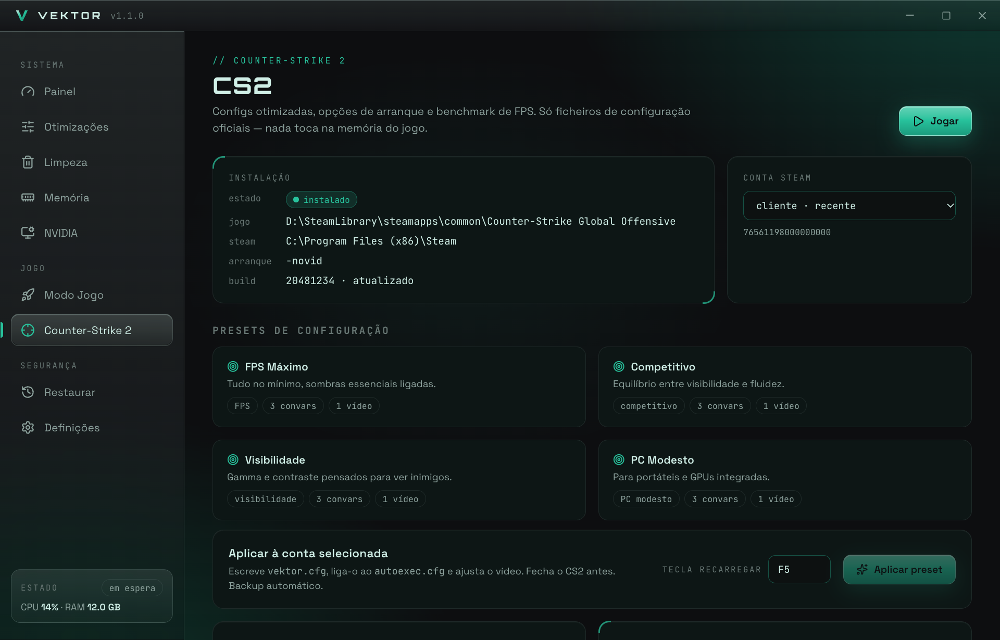

<p align="center">
  
</p>

<h1 align="center">Vektor</h1>

<p align="center">
  A Windows PC and Counter-Strike 2 optimizer.<br />
  Everything runs on your machine, and every change can be undone.
</p>

<p align="center">
  <a href="https://github.com/PedroGrilo/vektor/releases/latest"></a>
  <a href="https://github.com/PedroGrilo/vektor/actions/workflows/build-windows.yml"></a>
</p>



<sub>Screenshots show the app with demo data. The interface is in Portuguese (PT-PT).</sub>

## What it does

- **Tunes Windows for games** with 22 tweaks you switch on one by one, or with a single "Optimize now" button that only applies the low-risk ones.
- **Frees disk space** by cleaning temporary files and caches, after showing you what it found.
- **Keeps memory free while you play** with a small background service that clears the Windows standby list.
- **Optimizes the NVIDIA driver profile**, globally and for CS2 only.
- **Sets up Counter-Strike 2**: config presets, launch options and an FPS benchmark with history.
- **Boosts the PC while CS2 is running** (closes chosen apps, pins CPU cores, switches resolution) and puts everything back when you quit.
- **Undoes anything**: every change is recorded first, so one click restores the original value.

## Download and install

1. Open the [latest release](https://github.com/PedroGrilo/vektor/releases/latest) and download `Vektor_x.y.z_x64-setup.exe`.
2. Run it. Windows SmartScreen will say "Unknown publisher" because the installer has no paid code-signing certificate: choose **More info → Run anyway**.
3. Start Vektor. It asks for administrator rights each time, because it changes system settings.

Requirements: Windows 10 or 11, 64-bit. The installer downloads the WebView2 runtime if your PC does not have it (Windows 11 already includes it).

From version 1.1.0 on you do not need to come back here for new versions: Vektor checks for updates itself and installs them from **Definições → Atualizações**.

## Screenshots

| | |
|---|---|
| **Windows tweaks** — each one shows its risk and whether it needs a restart | **Memory** — what your RAM is doing and why the service purged or not |
|  |  |
| **NVIDIA** — global profile and a profile just for CS2 | **Game Mode** — applied while CS2 runs, reverted when it closes |
|  |  |



## Features

### Windows tweaks

All 22 are reversible. Each is labelled low, medium or high risk and says if it needs a restart.

| Area | Tweaks |
|---|---|
| Power | High-performance power plan without core parking or USB selective suspend; power throttling off |
| GPU | Hardware-accelerated GPU scheduling; Multiplane Overlay off (a fix for flicker on some setups) |
| System | Windows Game Mode; Game DVR capture off; multimedia scheduler priorities for games; foreground priority boost; optimizations for windowed games; visual effects and transparency off; background apps off |
| Windows 11 | Widgets off; Edge startup boost and background mode off; Windows Update peer-to-peer sharing off |
| Input | Mouse acceleration off; accessibility hotkeys off, so pressing Shift five times no longer kicks you out of the game |
| Network | Multimedia network throttling off |
| Privacy | Telemetry service off |
| CS2 | High CPU priority, high-performance GPU and no fullscreen optimizations for `cs2.exe` |

"Optimize now" on the dashboard only applies low-risk tweaks that need no restart. The rest stay opt-in.

### Cleanup

Scans 15 locations and shows the size of each before deleting anything: temporary files, the Windows internet cache, error reports, crash dumps, thumbnails, prefetch, shader caches (drivers and Steam), Steam web cache, Windows Update downloads, Delivery Optimization files, old driver installers, the recycle bin and the DNS cache. Items with side effects carry a warning, and the riskier ones are not selected by default.

It can also close a fixed list of background apps. Steam and CS2 are never on that list.

### Memory

Windows keeps recently used files in a "standby" cache and sometimes fails to release it fast enough, which shows up as stutter. Vektor installs a small Windows service, `VektorMemory`, that clears the standby list when it grows past a size you choose **and** free memory drops below a limit you choose. This is the same idea as the well-known ISLC tool.

The page shows how RAM is split between in use, modified, standby and free, and tells you which half of the rule is met right now. There is also a "Purge now" button.

#### Suggested settings

The second slider is the one that matters: it is how much free memory you want Windows to always have. A good starting point is about one eighth of your RAM. From version 1.1.2 the app works this out for your PC and fills it in when you press **Usar sugerido**; nothing changes until you save.

| Your RAM | Purge when standby exceeds | …and free memory is below | Check every |
|---|---|---|---|
| 8 GB | 1024 MB | 1024 MB | 5 s |
| 16 GB | 1024 MB | 2048 MB | 5 s |
| 32 GB or more | 1024 MB | 4096 MB | 5 s |

It is a formula, not a fixed table, so any amount of RAM works: 12 GB gives 1536 MB, 20 GB gives 2560 MB, 24 GB gives 3072 MB. From 32 GB up (40, 48, 64 GB...) it stays at 4096 MB, because keeping more than 4 GB free brings no benefit.

- These are starting points, not measured optima. If you still get stutter when memory fills up, raise the second value one step at a time.
- Seeing "0 purges" does not mean it is broken. It means free memory never dropped below your limit, which is normal on PCs with 32 GB or more.
- Avoid setting the free-memory limit to half of your RAM, as some guides suggest. The service would purge almost all the time and throw away cache that Windows uses to load files faster, for no gain.

### NVIDIA

Uses [NVIDIA Profile Inspector](https://github.com/Orbmu2k/nvidiaProfileInspector) (MIT, bundled) to set low latency mode, maximum-performance power management, high-performance texture filtering and an unlimited shader cache. There is a global profile and a separate one for `cs2.exe` that can also force V-Sync off. The original profile is saved before the first change and can be restored.

### Game Mode

A watcher notices when `cs2.exe` starts and, if you enabled it:

- closes the apps you picked, and reopens them afterwards;
- pins the game to the best CPU cores (automatic for Ryzen X3D and dual-CCD chips, or a manual mask);
- switches the display resolution, for example to a 4:3 mode;
- raises digital vibrance while the game has focus (AMD only for now).

When the game exits, everything is put back. If Vektor crashes mid-session, it cleans up the next time it starts.

### Counter-Strike 2

- Finds Steam, the game and your accounts.
- Four config presets (max FPS, competitive, visibility, low-end PC), written as `vektor.cfg` and hooked into `autoexec.cfg`, plus video settings.
- Recommended launch options.
- An FPS benchmark with average and 1% low, and a history that compares each run with your first one.
- Tells you when Steam has a CS2 update pending.

Vektor only writes the game's own config files. It never reads or writes game memory and injects nothing into the game.

### Restore

Before any change, the previous value goes into a journal at `%ProgramData%\Vektor\journal.json`, and files are backed up before being overwritten. You can revert a single tweak or everything at once, even after a restart.

### The app itself

- Lives in the system tray and can start with Windows.
- In-app updates from GitHub releases (see below).
- Exports a diagnostics `.zip` for support, with no Steam account names or IDs in it.
- Stops polling CPU and RAM while minimized or in the tray, so it stays out of the way during a match.

## Privacy and safety

- No account, no server, no telemetry. Nothing about your PC leaves it.
- The only network request Vektor makes on its own is the update check, to GitHub.
- It runs as administrator because the settings it changes (system registry, services, power plans, driver profiles) require it.
- Updates are verified with a digital signature before they are installed, so a tampered download is rejected.

## Updates

Vektor checks the latest GitHub release when it starts and every six hours. If there is a new version, a button appears in the sidebar and in **Definições → Atualizações**. Nothing is installed until you press it. You can turn the automatic check off on the same page.

If you still have version 1.0.0, install 1.1.0 by hand once. Updates arrive in the app from then on.

## Project status

Vektor is young. The logic is covered by unit tests and every release is built by CI on Windows, but several Windows-specific paths still need testing on more hardware. Reports are welcome in [Issues](https://github.com/PedroGrilo/vektor/issues), especially about:

- the `VektorMemory` service on different Windows builds;
- NVIDIA profile changes across driver versions;
- the in-app update flow;
- CPU affinity detection on unusual processors;
- digital vibrance on AMD cards and resolution switching on multi-monitor setups.

## Build from source

You need [Bun](https://bun.sh) and [Rust](https://rustup.rs). The full app only builds and runs on Windows.

```sh
bun install
./scripts/fetch-npi.sh   # downloads NVIDIA Profile Inspector and checks its hash
bun run dev              # interface only, in a browser, with demo data
bunx tauri dev           # the full app (Windows)
bunx tauri build         # the installer (Windows; needs the updater signing key)
```

On macOS or Linux you can still work on the interface with `bun run dev`, run the tests with `cd src-tauri && cargo test --lib`, and type-check the Windows code with `cargo clippy --target x86_64-pc-windows-msvc --lib` (needs the Rust Windows target and `llvm-rc`).

### How it is put together

- **Tauri 2**: a Rust backend in `src-tauri/` and a React interface in `src/`.
- `src/api.ts` is the contract between the two. `src-tauri/src/commands.rs` exposes the commands; the logic lives in modules (`tweaks`, `cleanup`, `memory`, `nvidia`, `session`, `cs2`, `journal`, `updates`).
- `src/mock.ts` provides demo data so the interface runs in a plain browser.
- The memory service is `vektor.exe` itself, started with `--memory-service`. It talks to the app through two small JSON files, with no open ports or pipes.
- Colours come from five values in `src/styles.css`; everything else is derived from them. The glass effect is used on bars and buttons only, to keep the interface light.

### Releasing

1. Set the same version in `package.json`, `src-tauri/Cargo.toml` and `src-tauri/tauri.conf.json`. CI fails if they differ from the tag.
2. Write `RELEASE_NOTES.md`. It becomes the release text and is shown inside the app.
3. Push a tag: `git tag vX.Y.Z && git push origin main vX.Y.Z`.

CI builds the installer, signs it, generates the `latest.json` the app reads, and publishes the release. Signing uses the `TAURI_SIGNING_PRIVATE_KEY` repository secret. Its public half is in `src-tauri/tauri.conf.json`. If that private key is lost, existing installs can no longer be updated.

## Credits

By **Kicas** aka **Pedro Grilo** — [github.com/PedroGrilo](https://github.com/PedroGrilo)

Third-party software: [NVIDIA Profile Inspector](https://github.com/Orbmu2k/nvidiaProfileInspector) by Orbmu2k, MIT licence, downloaded at build time and shipped with the installer.

Vektor is an independent project. It is not affiliated with or endorsed by Valve, NVIDIA, AMD or Microsoft. Counter-Strike is a trademark of Valve Corporation.
